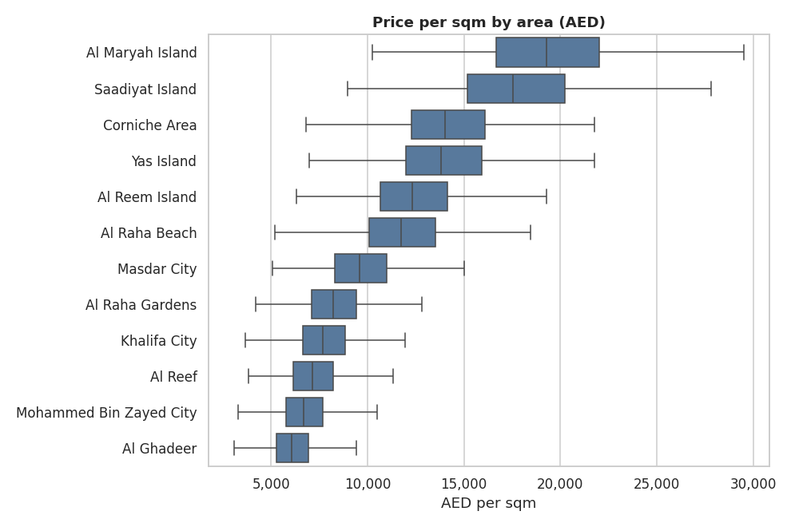
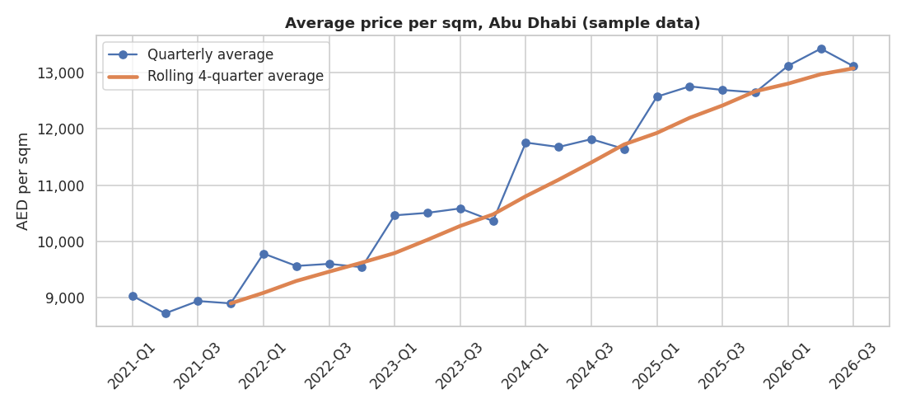
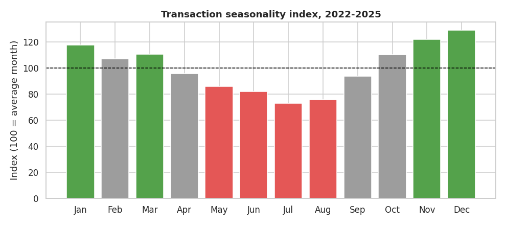
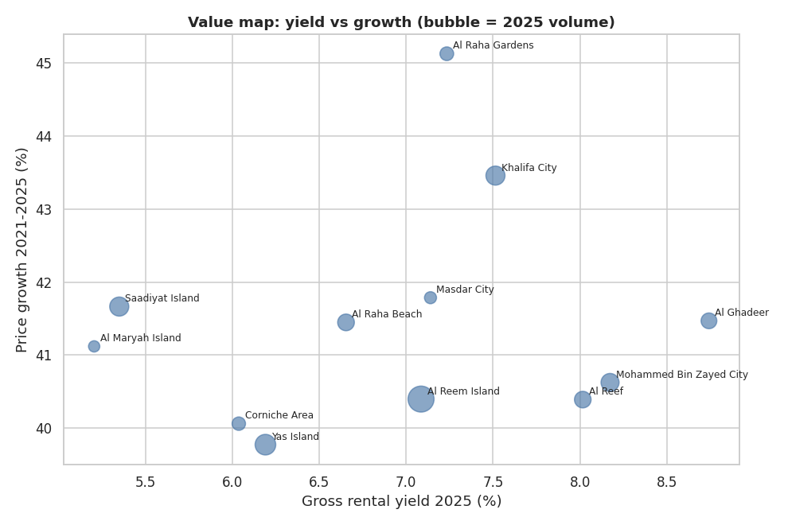
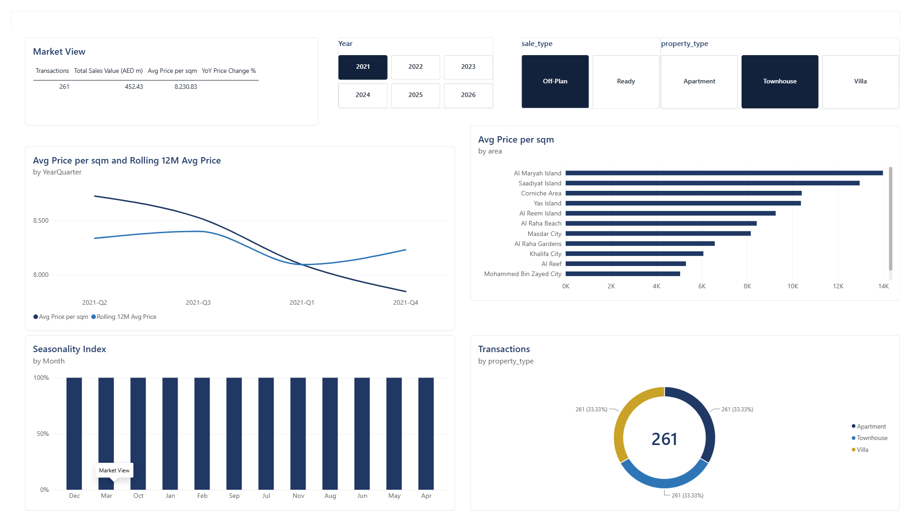
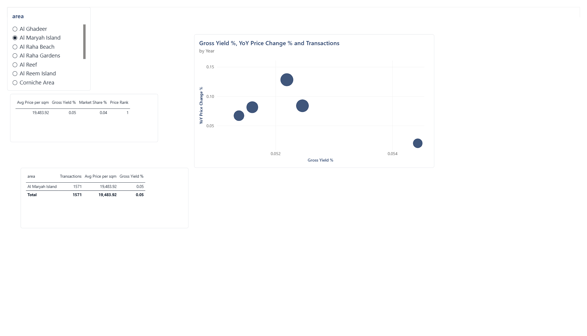

# Abu Dhabi Real Estate Market Analysis

End-to-end analysis of sales and rental activity across 12 Abu Dhabi areas: data cleaning (Python), analysis (SQL), reporting (Excel), and an interactive dashboard (Power BI).

> **Important data note:** the files in `data/raw/` are **synthetic sample data** generated by `src/generate_sample_data.py`, built to look like a real, messy market dataset. All findings below are **illustrative, not real market facts**. 

## Business Problem
A property investor or first-time buyer in Abu Dhabi asks: **which areas offer the best value, how have prices moved, and when is the best time to transact?** This project answers with price tiers, growth, rental yield, and seasonality by area.

## Data
| Table | Rows (raw -> clean) | Fields |
|---|---|---|
| Sales transactions | 43,744 -> 41,021 | date, area, property type, bedrooms, size, price, off-plan/ready |
| Rental contracts | 14,900 -> 14,900 | start date, area, property type, size, annual rent |

Period: Jan 2021 - Sep 2026 (2026 is a partial year).

**Cleaning log** (see `notebooks/01_cleaning_eda.ipynb`): 646 duplicate IDs removed; 20+ area spelling variants standardised to 12 names; mixed date formats parsed; 1,702 rows with missing price/size dropped; 170 impossible sizes (< 20 sqm) dropped; 205 price/sqm outliers removed (3 x IQR within area).

**Limitations:** synthetic data; averages are influenced by property mix (apartments vs villas); no adjustment for floor, view, or building quality; gross yield ignores service charges and vacancy.

## Tools
Python (pandas, matplotlib, seaborn) | SQL (SQLite, window functions and CTEs) | Excel (formula-driven summary) | Power BI (DAX)

## Key Findings (on the sample data)
1. **Price tiers are wide:** Al Maryah Island (~AED 19.5k/sqm) and Saadiyat (~17.8k) cost about 3x Al Ghadeer (~6.2k).
2. **Yield falls as price rises:** gross yield in 2025 ranges from ~8.7% in Al Ghadeer to ~5.2% in Al Maryah. Suburban areas lead on income; island areas are priced for prestige and capital value.
3. **Growth was steady and similar across areas:** market average price/sqm rose about 42% from 2021 to 2025, with YoY changes between 8% and 12%. Al Raha Gardens and Khalifa City grew slightly faster than the rest.
4. **Strong seasonality:** transaction volume peaks in Nov-Jan (index 117-129) and is weakest in Jul-Aug (index ~73-75).
5. **Best blended value (yield + growth):** Al Ghadeer, Al Raha Gardens, Khalifa City, and MBZ City rank top four on a simple total-return proxy.
6. **No clear off-plan premium** in this dataset (differences within +/-2%); this needs to be checked on real data.

## Charts





## Dashboard
DAX measures and a theme are in [`dashboard/POWERBI_BUILD_GUIDE.md`](dashboard/POWERBI_BUILD_GUIDE.md).


 
 

## Recommendations
- **Income-focused investors:** screen Al Ghadeer, MBZ City, Al Reef, and Khalifa City first; verify service charges and tenant demand before buying.
- **Capital-growth / prestige buyers:** Saadiyat, Yas, and Al Maryah offer lower yields; the case rests on scarcity and lifestyle, not income.
- **Timing:** negotiate and shop in the slower summer months (Jul-Aug) when volume is lowest; expect more competition in Q4/Q1.


## Repository Structure
```
abudhabi-real-estate-analysis/
├── README.md
├── requirements.txt
├── data/
│   ├── raw/                      synthetic sample data (replace with real data)
│   └── clean/                    cleaned CSVs, SQLite DB, SQL result CSVs
├── notebooks/01_cleaning_eda.ipynb
├── sql/analysis_queries.sql      10 queries: CTEs, window functions, joins
├── src/
│   ├── generate_sample_data.py
│   ├── clean_data.py
│   ├── run_sql.py
│   └── build_excel.py
├── excel/summary_pivot.xlsx      formula-driven summary + charts
├── dashboard/                    Power BI guide, DAX, theme, screenshots
├── docs/figures/                 charts used in this README
└── reports/one_page_summary.md
```

## How to Run
```bash
pip install -r requirements.txt
python src/generate_sample_data.py   # skip if using real data
python src/clean_data.py             # raw -> data/clean/
python src/run_sql.py                # loads SQLite, runs sql/analysis_queries.sql
python src/build_excel.py            # builds excel/summary_pivot.xlsx
jupyter notebook notebooks/01_cleaning_eda.ipynb
```
“Open dashboard/real_estate.pbix in Power BI Desktop”

## SQL Skills Demonstrated
Aggregation and `GROUP BY` | CTEs | `LAG` / `RANK` window functions | rolling-window frames | conditional aggregation (`CASE WHEN`) | joins across tables | derived KPIs (yield, value score)

## About Me
**Banupriya Muthuvel** | Data Analyst |Power BI, SQL, Python| Abu Dhabi, UAE | mailto:banupriya.muthuvel@gmail.com
